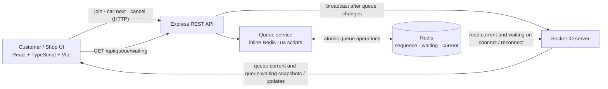

# Coding task

A working full-stack queue-calling MVP for an interview demo. Customers can take a numbered ticket, see the latest number being served, and cancel while they are waiting. Shop staff can see the ordered waiting tickets and call the next customer. The demo has one public queue and does not require sign-in.

## Run the project

Requirements: Docker and Docker Compose v2.

From the project root, build and start the frontend, backend, and Redis:

```sh
docker compose up --build
```

Open [http://localhost:5173](http://localhost:5173) and select **Customer** or **Shop**. The two screens are also available directly at `/customer` and `/shop`. The backend listens on port `3000`; Redis is available to the backend inside the Compose network. Stop the services with `Ctrl+C`.

## Ai-workflow for this project

I used mainly Codex for this project and spent approximately 2–3 hours on it. First, I used ChatGPT to brainstorm what I should do and discuss the architecture. I chose a Redis sorted set primarily because I had implemented a queue system with it in a previous project at another company.

Next, I created the first version of the agents.md file to guide the agent. For the coding agent, I mainly used Codex. I used planning mode first, and then checked whether the plan aligned with my thoughts. After the coding agent executed, I opened other threads to conduct a code review for the changes. Finally, I reviewed the code myself. If a feature I wanted to implement was too large, I split it into multiple parts and repeated the same process.

## Demo walkthrough

1. In one browser tab, open **Customer** and choose **Take a number**. The screen shows the assigned ticket (for example, `A001`) and **Now Serving**.
2. In a second tab or window, open **Shop** and check **Waiting Queue**. The list updates when customers join or cancel.
3. Choose **Call next**. Check that the called ticket appears on both screens and is removed from the Shop’s waiting list. Reload either screen to see the latest queue snapshots restored.
4. To try cancellation, take another number and cancel it before Shop calls it.

## Architecture



Redis is the source of truth and stores the queue sequence, waiting sessions, and latest called ticket. Inline Lua scripts allocate, call, and cancel tickets atomically. Ticket IDs are assigned by the backend; the browser stores its customer session UUID and returned ticket ID in local storage. REST handles join, call-next, and cancel mutations, and `GET /api/queue/waiting` returns `{ "waitingTickets": ["A001", "A002"] }` in FIFO order. Socket.IO sends `queue:current` and `queue:waiting` snapshots on connect/reconnect, then broadcasts updated state after successful queue changes. Waiting snapshots contain ticket IDs only. The demo has no authentication, so the waiting endpoint and socket data are public to anyone who can reach the backend.

The project runs as three Compose services: the Vite frontend, the Express/Socket.IO backend, and Redis. No separate database, broker, or worker is required.

## Checks

Frontend checks:

```sh
cd frontend
npm ci
npm run build
npm test
```

The frontend suite covers role links, saved-ticket restore, join retry with the same UUID, cancellation responses, socket snapshot/update/reconnect, REST request shapes, and empty Call Next behavior.

The backend integration suite uses real Redis:

```sh
docker compose exec -T -e REDIS_URL=redis://redis:6379 backend npm test
```
